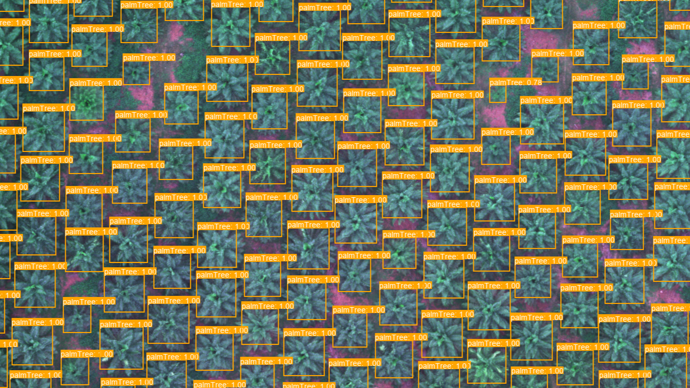
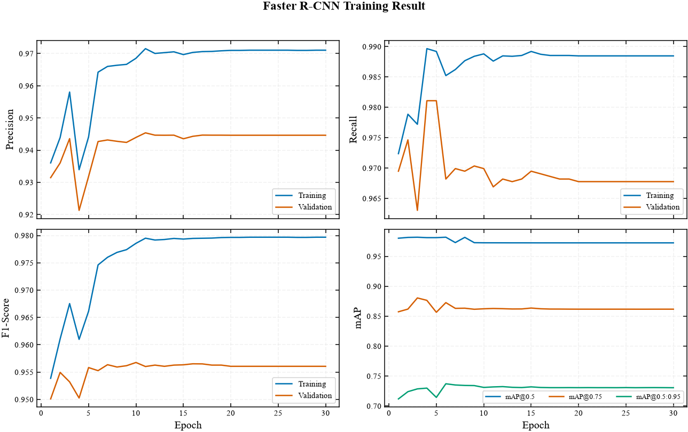

# Oil Palm Tree Detection

<div align="center">
    
</div>

This project provides an oil palm tree detection pipeline for UAV imagery using PyTorch and Torchvision object detection models. The dataset uses COCO annotations with `palmTree` as the main class.

> **Note:** This project currently focuses on object detection. It does not calculate NDRE, NDVI, tree height, or other vegetation metrics. The pipeline has not yet been tested on other datasets.

## Repository Structure

```text
ndvi_analysis/
├── checkpoints
├── dataset
├── detection_result
├── doc
├── .gitignore                    
├── config.py                      
├── dataset.py      
├── inference.py                   
├── model.py                       
├── README.md                           
├── train.py
└── training_evaluaiton.ipynb
```

Each training run in `checkpoints/` usually contains:

```text
run_<date>_<timestamp>/
├── config_used.yaml
├── training_log.csv
├── best.pt
└── last.pt
```

## Installation

```bash
python -m venv .venv
```

Activate the environment:

```bash
.venv\Scripts\Activate
```

Install PyTorch and Torchvision first by following the official guide. Choose
the CPU or CUDA build appropriate for your system:
https://pytorch.org/get-started/locally/

```bash
pip install -r requirements.txt
```

Register the environment as a Jupyter kernel:
```bash
python -m ipykernel install --user --name myenv --display-name "Python (myenv)"
```

## Dataset

The dataset is not uploaded with this repository. Provide your own dataset in
the COCO format before running training. The training and validation splits
must each contain `_annotations.coco.json` and all images referenced by that
file. For inference, provide a GeoTIFF in `dataset/test/` and the training
annotations file, which is used to determine the model's class count.

You can create and annotate a dataset with [Roboflow](https://universe.roboflow.com/),
then export it in COCO format. Make sure the exported annotation file is named
`_annotations.coco.json` and place each split in the corresponding directory
shown below.

Before training, check the `categories` section in both the training and
validation annotation files. Category IDs must be unique, every annotation's
`category_id` must refer to a listed category, and category names must match
between splits. For this project, the current category is:

```json
{
  "id": 1,
  "name": "palmTree",
  "supercategory": "none"
}
```

The current training and validation annotations both use this category, and
their annotations refer to category ID `1`. If you use different class names
or multiple classes, update `category_names` in `config.py` in the same order
as the categories in the training annotations.

You need to prepare the dataset yourself and train the model before running
inference. Training creates the checkpoint required by the inference
configuration; pretrained project checkpoints are not included in this
repository.

```text
dataset/
    ├── train/
    │   ├── _annotations.coco.json
    │   ├── <image>
    │   └── ...
    ├── valid/
    │   ├── _annotations.coco.json
    │   ├── <image>
    │   └── ...
    └── test/
        └── <image_test.tif> # with georeference
```

## Configuration

The main configuration is stored in [config.py](config.py) as the `CONFIG` dictionary:

```python
CONFIG = {
    "dataset": {
        "ann_file": "_annotations.coco.json",
        "train": "dataset/train",
        "valid": "dataset/valid",
        "dataloader": {
            "batch_size": 8,
            "num_workers": 1,
        },
    },
    ...
```

## Training

Run the command from the project root:

```bash
python train.py
```

`train.py` imports `CONFIG` from `config.py`, creates the training and validation DataLoaders, evaluates COCO metrics after each epoch, and saves the results in a new directory such as:

```text
checkpoints/run_<date>_<time>/
```

Generated files include:

- `best.pt`: checkpoint with the best validation mAP@0.50;
- `last.pt`: checkpoint from the final epoch;
- `training_log.csv`: loss, mAP, and epoch timing;
- `config_used.yaml`: configuration snapshot for the run.

## GeoTIFF Inference

Update the `inference` section in [config.py](config.py). For example:

```python
    "inference": {
        "model_path": "checkpoints/<run_folder>/best.pt",
        "model_type": "torchvision",
        "image_path": "dataset/test/<your_geotiff>.tif",
        "tile_size": 512,
        "conf_threshold": 0.5,
        "overlap": 0.2,
        "postprocess": "NMS",
        "save_result_dir": "detection_result",
        "category_names": ["palmTree"],
    }
```

Replace `<run_folder>` and `<your_geotiff>.tif` with the checkpoint directory
and GeoTIFF filename you want to use, then run:

```bash
python inference.py
```

`inference.py` reads the input GeoTIFF, checkpoint, and output directory from
the `inference` section in `config.py`. The raster must include a CRS so
detections can be georeferenced. The output overlay and shapefile are saved as:

```text
detection_result/
├── <image_name>_detections.png
├── <image_name>_detections.shp
├── <image_name>_detections.shx
├── <image_name>_detections.dbf
├── <image_name>_detections.prj
└── <image_name>_detections.cpg
```

The shapefile contains each detection's `class` and `confidence` attributes,
along with its bounding-box geometry in the raster's CRS.

## Evaluation

The training log records mAP@0.50, mAP@0.75, mAP@[0.50:0.95], precision, recall,
and F1-score for the training and validation. The best
checkpoint is selected using validation mAP@0.50.

